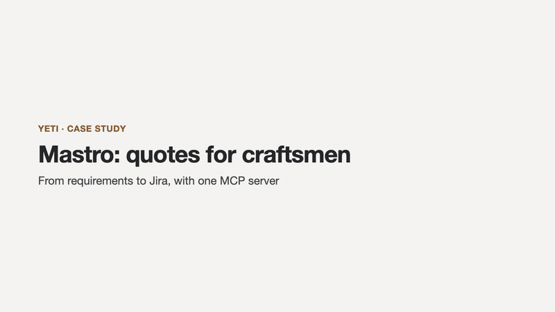

# Yeti

[](https://www.npmjs.com/package/yeti-mcp) [](https://github.com/macorifice/yeti/actions/workflows/ci.yml) [](LICENSE)

<a href="https://mcprush.com/to/yeti-mcp"></a>

An [MCP](https://modelcontextprotocol.io) server for product design with Claude. It takes a project from the problem to a verified scope: requirements, user stories, RICE priorities and flow diagrams. Then it sends the work to Jira.


## Quick start

Add Yeti to Claude Desktop, in `claude_desktop_config.json`, then restart Claude Desktop:

```json
{
  "mcpServers": {
    "yeti": {
      "command": "npx",
      "args": ["-y", "yeti-mcp"],
      "env": { "PRODUCT_DESIGN_DB": "/Users/you/yeti/yeti.sqlite" }
    }
  }
}
```

Set `PRODUCT_DESIGN_DB` to a file in a folder you keep. With `npx` the package lives in a cache that can be cleared, and a database stored there would go with it. Yeti needs Node.js 22.13 or later.

Then ask Claude:

> Create a project "Quotes for craftsmen" with Yeti. Problem: writing quotes takes hours. Users: plumbers and painters. Goal: a quote in five minutes.

> Open the Yeti dashboard.

## How it works

A project goes through five phases, in order:

1. **discovery**: problem, users and goal
2. **definition**: requirements (MoSCoW) and user stories
3. **prioritization**: RICE scoring of ideas
4. **flows**: Mermaid flow diagrams
5. **verification**: every `must` requirement completed and covered by a user story, then the project closes

Projects have a mode, chosen at creation:

- **`strict`** (default): a phase advances only when its requirements are met. `advance_phase` tells you what is missing.
- **`free`**: phases advance regardless, and the response lists what was skipped.

## Tools

**Projects**

| Tool | What it does |
| --- | --- |
| `create_project` | Start a project in the discovery phase, in `strict` or `free` mode |
| `list_projects` | List projects with id, name, phase and mode; archived ones are hidden unless `includeArchived` is set |
| `get_project` | Show phase, what is missing, and linked items |
| `project_summary` | Progress overview: requirements by priority and status, musts covered by stories, criteria done, RICE leader, Jira links, and what is missing to close |
| `update_project` | Change a project's name, problem, users or goal |
| `advance_phase` | Move to the next phase, or list what is missing |
| `set_project_mode` | Switch a project between `strict` and `free` |
| `duplicate_project` | Copy a project's requirements and stories into a new project, as open items (a template) |
| `archive_project` | Hide a project from `list_projects` without deleting it |
| `delete_project` | Permanently delete a project and its items. Requires `confirm: true`; Jira issues are not touched |

**Requirements and user stories**

| Tool | What it does |
| --- | --- |
| `add_requirement` | Add a requirement with a MoSCoW priority |
| `list_requirements` | List requirements, filtered by priority, status or project |
| `update_requirement` | Change a requirement's title, description or priority |
| `set_requirement_status` | Mark a requirement `open` or `done` |
| `delete_requirement` | Delete a requirement and unlink it from stories |
| `add_user_story` | Create a user story with acceptance criteria, optionally linked to requirements (`requirementIds`) |
| `list_stories` | List user stories with their ids, links, criteria state and Jira key |
| `update_user_story` | Change a story's persona, goal, benefit, linked requirements or criteria. Changing criteria resets their done state |
| `set_criterion_status` | Mark one acceptance criterion of a user story as done or not done |
| `delete_user_story` | Delete a user story |
| `search_items` | Search requirements and stories by text, optionally within one project |

**Prioritization and flows**

| Tool | What it does |
| --- | --- |
| `prioritize_rice` | Compute and sort RICE scores |
| `map_user_flow` | Generate a Mermaid flow diagram, with Yes/No branches, `next` and `ends` |
| `list_flows` | List the flow diagrams saved in a project, with their index |
| `delete_flow` | Delete one saved flow diagram, by the index shown by `list_flows` |

**Import, export and dashboard**

| Tool | What it does |
| --- | --- |
| `export_backlog` | Export a project backlog as Markdown or CSV; with `save`, also writes it to `data/exports/` |
| `import_requirements` | Import requirements and user stories from CSV in the `export_backlog` format. Story-to-requirement links are not restored |
| `open_dashboard` | Start the live, read-only dashboard and return its local address |
| `export_dashboard` | Write a static HTML snapshot of the dashboard to `data/exports/dashboard.html` |

**Jira**

| Tool | What it does |
| --- | --- |
| `push_to_jira` | Create Jira issues for a project (Task per requirement, Story per user story). Dry-run by default; `limit` sends a subset; `update` refreshes issues already linked; items already sent are skipped |
| `sync_from_jira` | Mark requirements and stories done when their Jira issue is done, and reopen them when it goes back. Items closed by hand in Yeti are not reopened. Read-only on Jira |

Requirements, stories, RICE scores and flows accept an optional `projectId` to link them to a project.

## Install from source

You need Node.js 22.13 or later (Yeti uses the built-in `node:sqlite` module).

```bash
git clone https://github.com/macorifice/yeti.git
cd yeti
npm install
npm run build
```

Then add it to `claude_desktop_config.json`, using the absolute path to `dist/index.js` on your machine:

```json
{
  "mcpServers": {
    "yeti": {
      "command": "node",
      "args": ["/absolute/path/to/yeti/dist/index.js"]
    }
  }
}
```

Restart Claude Desktop after editing the file.

## Usage

Once connected, you work with Yeti by talking to Claude. A typical project looks like this.

**1. Create a project**

> Create a project "Quotes for craftsmen". Problem: writing quotes takes hours. Users: plumbers and painters. Goal: a quote in five minutes.

Yeti creates the project in the `discovery` phase.

**2. Move through the phases**

- **definition**: add at least one requirement and one user story linked to it.
- **prioritization**: score the ideas with RICE.
- **flows**: draw at least one flow diagram.
- **verification**: every `must` requirement is done and covered by a user story.

In `strict` mode (the default), Yeti will not advance until the phase is complete, and it tells you what is missing. In `free` mode, it advances and lists what it skipped. You can switch with `set_project_mode`.

**3. Work on the backlog**

- Edit or delete requirements and stories.
- Mark acceptance criteria as done.
- Search across a project.
- Duplicate a project to reuse it as a template.
- Import requirements from a CSV file.

**4. Export**

> Export the project backlog as Markdown and save it to a file.

With `save: true`, the file is written to `data/exports/` next to the database.

**Good to know**

- Data is stored locally, in `data/yeti.sqlite`. The content still passes through the chat, so do not put sensitive data in it.
- RICE scores are the numbers you enter. Yeti sorts them; it does not estimate them.

## Case study

A small project from requirements to Jira, using the Mastro example: creating the project, requirements and user stories, RICE prioritisation, a flow diagram, the verification gate, sending to Jira, and keeping the status in sync.



## Dashboard

Yeti has a read-only dashboard for the design side of your projects: the phase each project is in, what is missing to move on, which musts are covered by user stories, acceptance criteria, RICE scores and flow diagrams. It does not show a task board: execution belongs in Jira.


Open it from Claude:

> Open the Yeti dashboard.

Claude calls `open_dashboard` and gives you an address such as `http://127.0.0.1:4321`. Or start it from a terminal:

```bash
npx yeti-mcp dashboard --port 4321
```

- It listens on `127.0.0.1` only, so it is not reachable from other machines, and it refuses requests for other host names.
- It reads the same database as the MCP server and refreshes every 10 seconds.
- Jira keys become links when `JIRA_SITE` is set.
- Diagrams are drawn with Mermaid, loaded from a CDN. Without a connection they are shown as text.

`export_dashboard` still writes a static snapshot to `data/exports/dashboard.html`, for sharing.

## Credentials

Yeti works without any account. Only one tool talks to an external service:

- **Everything else** (projects, requirements, stories, RICE, flows, verification, export, search) runs locally and needs no credentials.
- **`push_to_jira`** creates issues in Jira. It needs three environment variables:

| Variable | Value |
| --- | --- |
| `JIRA_SITE` | Your Jira site, e.g. `https://your-team.atlassian.net` |
| `JIRA_EMAIL` | The email of your Atlassian account |
| `JIRA_API_TOKEN` | An API token created at [id.atlassian.com](https://id.atlassian.com) → Security → API tokens |

Set them in your shell profile, for example in `~/.zshrc`:

```bash
export JIRA_SITE="https://your-team.atlassian.net"
export JIRA_EMAIL="you@example.com"
export JIRA_API_TOKEN="your-token-here"
```

Never put the token in the repository, in a config file you commit, or in a chat. If a token is exposed, revoke it in the same page and create a new one.

Without these variables, `push_to_jira` refuses to send and tells you which one is missing. Dry-run previews work without them as well.

## Data

Data is stored in SQLite. From a source checkout the default is `data/yeti.sqlite` inside the project folder; with `npx`, set `PRODUCT_DESIGN_DB` as shown in the quick start. Earlier versions used `data/db.json`: it is imported automatically the first time the new version runs, and then left untouched. To use another location, set the `PRODUCT_DESIGN_DB` environment variable:

```json
"env": { "PRODUCT_DESIGN_DB": "/absolute/path/to/yeti.sqlite" }
```

## Test

```bash
npm test
```

The test starts the server on a temporary database and checks every tool and the phase flow.

## Status

Stable since 1.0.0. The tools, their inputs and the data format are covered by semantic versioning: breaking changes will come with a new major version.

## Sponsor

If Yeti is useful to you, you can support its development through [GitHub Sponsors](https://github.com/sponsors/macorifice).

## License

MIT. See [LICENSE](LICENSE).
